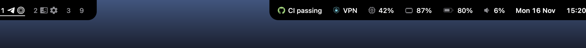

# wingbar

**A native macOS status bar written in Rust: light enough to forget about, simple enough to configure from the bar itself.**

[](https://github.com/iammosab/wingbar/actions/workflows/ci.yml)
[](LICENSE)




wingbar draws two black "wings" at the top of each screen, one on each side, and
leaves the middle (and the notch) free. The left wing shows your AeroSpace or yabai
workspaces, the right wing your widgets. A widget is either built in or a script
that prints one line.

It is a single small program: no web engine, no Node server, no polling for
things macOS already announces. It uses about 0.25 % of one CPU core and about
16 MB of memory, measured with `scripts/measure.sh`.

## Why wingbar exists

The popular way to get a custom bar on macOS is [Übersicht](https://tracesof.net/uebersicht/)
with [simple-bar](https://github.com/Jean-Tinland/simple-bar). It looks great,
but it runs a full web view plus a Node.js server to draw a strip of text, and
widgets keep shelling out on timers. On a laptop that adds up to a bar that is
always awake.

wingbar keeps what made that setup nice (workspaces, script widgets, colours,
icons, click actions, AeroSpace hooks) and fixes the cost:

| Problem with a web-based bar | What wingbar does instead |
| --- | --- |
| A web view redraws the whole bar | Draws only the two wings, each only as wide as its widgets, and redraws only the wing that changed |
| CPU, memory, battery and volume read by running commands | Reads them in-process from the kernel, IOKit, CoreAudio and Accessibility |
| Widgets poll for battery, volume, app switches, wake, now playing | macOS pushes these events; nothing polls for them |
| Many timers waking the machine | One scheduler thread that sleeps until the next widget is due; the clock wakes once a minute, on the minute |
| Settings edited by hand, then reload | Right-click menu and a CLI to add, move, hide and remove widgets; changes apply at once |
| Adding a widget that has nothing to show looks broken | wingbar tells you when the widget will appear, or why its script failed |

Coming from Übersicht + simple-bar? wingbar imports your `~/.simplebarrc` the
first time it starts, and keeps your scripts, colours, icons, click actions and
AeroSpace hooks working. simple-bar's icons are bundled.

## Features

- **Workspaces** for [AeroSpace](https://github.com/nikitabobko/AeroSpace) and
  [yabai](https://github.com/koekeishiya/yabai), with optional app icons per
  workspace. Click to focus, scroll to cycle.
- **Built-in widgets:** window title, CPU, memory, battery, sound (scroll to change
  the volume), date, time, Spotify and Music.
- **Script widgets:** any command that prints `level|label`. Each level gets its
  own colour and icon, and a script can add a click or hover menu.
- **A catalog of ready-made widgets:** storage, network, microphone, adb (Android
  devices), AeroSpace mode, git branch.
- **Icons:** any SF Symbol, or one of the bundled icons (simple-bar's library of
  about 260 icons).
- **Manage everything from the bar:** right-click a wing to move, hide, remove or
  add widgets, or use `wingbar widget …` from a terminal.
- **Hot reload:** save the settings file and the bar updates. A bad value is
  reported and replaced by its default; the rest of the file still applies.
- **Multiple screens**, and a local HTTP API compatible with simple-bar-server's
  routes, so existing window manager hooks keep working.

## Requirements

- macOS 14 (Sonoma) or newer, Apple Silicon or Intel
- Optional: AeroSpace or yabai for workspaces
- Only to build from source: Rust 1.88 or newer

## Install

**One line** (recommended; switches over from Übersicht + simple-bar for you):

```bash
curl -fsSL https://raw.githubusercontent.com/iammosab/wingbar/main/install.sh | bash
```

This downloads the latest release, installs it to `~/Applications/Wingbar.app`,
starts it at login (a LaunchAgent), and links the `wingbar` command into
`~/.local/bin`. If Übersicht + simple-bar are running, it stops them and parks
simple-bar-server's LaunchAgent so the two bars don't overlap. Run it again to
update.

**Homebrew:**

```bash
brew install iammosab/tap/wingbar
brew services start wingbar
```

Homebrew doesn't touch Übersicht: quit it and remove it from your login items
yourself. Update with `brew upgrade wingbar`.

**From source:**

```bash
git clone https://github.com/iammosab/wingbar.git
cd wingbar
./install.sh              # builds with cargo; ./install.sh --download installs the release instead
```

macOS asks once for **Accessibility** permission. wingbar uses it only to read
the focused window's title.

On first start wingbar writes `~/.config/wingbar/config.json`. It imports
`~/.simplebarrc` if you have one; otherwise you get a default bar with workspaces
(when AeroSpace or yabai is installed), window title, CPU, memory, battery,
sound, date and time.

<details>
<summary>Downloaded the zip from the Releases page in a browser?</summary>

The app is signed ad hoc, not with an Apple Developer ID, so macOS blocks a copy
that came through a browser ("Wingbar can't be opened"). The two commands above
don't have this problem. For a browser download, clear the quarantine flag once:

```bash
xattr -dr com.apple.quarantine Wingbar.app
```

</details>

To remove it:

```bash
curl -fsSL https://raw.githubusercontent.com/iammosab/wingbar/main/uninstall.sh | bash
# or ./uninstall.sh in a clone; with Homebrew: brew services stop wingbar && brew uninstall wingbar
```

This removes wingbar and brings Übersicht + simple-bar back if you had them.
Your settings in `~/.config/wingbar` are kept.

## Usage

### From the bar

**Right-click a wing** to open the wingbar menu. From there you can:

- move, hide or remove the widget under the pointer;
- tick widgets on and off;
- add a built-in widget, a catalog widget or your own script;
- open the settings file, reload, or quit.

On a widget that has its own right-click action, use ⌥-right-click or ⌃-click.

### From the command line

```bash
wingbar widget list                    # every widget, where it is, and its last error
wingbar widget catalog                 # what you can add
wingbar widget add storage             # a catalog widget (its script goes to ~/.config/wingbar/widgets/)
wingbar widget add time --as utc --left --at 1
wingbar widget add script --as vpn --command "bash ~/bin/vpn.sh" --every 10s
wingbar widget move cpu --after memory
wingbar widget hide cpu                # off the bar, settings kept
wingbar widget show cpu --right
wingbar widget set cpu every 5s
wingbar widget remove vpn              # settings deleted, script files kept

wingbar config path | check | edit
wingbar config import-simplebar [--from PATH] [--dry-run] [--force]

wingbar status | reload | refresh [WIDGET] | quit
```

Every command edits `config.json` and tells the running bar to reload. Editing
the file by hand works too: wingbar notices when you save it.

A widget with nothing to show takes no room, for example Spotify while nothing
plays, or a script that prints an empty line. When you add a widget that is
empty after its first run, the menu and the CLI tell you so, and say when it will
appear or why its script failed.

## Write your own widget

A widget is any command that prints its state on line 1:

```text
ok|Ethernet          level|label   (a line without "|" is level ok)
warn|84%             warn and alert colour the widget orange and red, dim greys it
icon: wifi           optional: the icon for this run (see Icons)
menu: Open Network Settings | open 'x-apple.systempreferences:com.apple.Network-Settings.extension'
menu: 192.168.1.20   a menu line without a command is shown, not clickable
menu: ---            separator
```

An empty line 1 hides the widget. Menu lines turn the widget into a menu that
opens on click, or on hover with `"menuOn": "hover"`.

Add the widget with `wingbar widget add script --as NAME --command "…"`, then
tune it in `config.json`:

```json
"vpn": {
  "type": "script",
  "command": "bash ~/bin/vpn.sh",
  "every": "10s",
  "icon": "lock.shield",
  "levels": { "ok": "green", "off": { "color": "dim", "icon": "lock.open" } },
  "click": "open -a 'Tunnelblick'"
}
```

Any level name works, and each one can have its own colour and icon. A script
runs in its own process group with a 30-second limit, and at most 64 lines of
its output are read.

> **Note:** the part of a `menu:` line after the first `|` is run as a command.
> Remove `|` and control characters from text your script doesn't control (a
> network name, a branch, a device name) before putting it in a menu line. With
> `"raw": true`, line 1 is shown as it is and no other lines are read.

The catalog widgets in [`catalog/`](catalog) are plain bash and make good
starting points.

## Settings

The settings file is `~/.config/wingbar/config.json`, or the path in
`$WINGBAR_CONFIG`. [`config.example.json`](config.example.json) lists every
option. In short:

- `left` and `right` place widgets, in order. A widget defined under `widgets`
  but in neither list is hidden and doesn't run.
- `widgets` defines each widget by key: its `type` and options (`every`, `click`,
  `rightClick`, `middleClick`, `icon`, `levels`, `menuOn`, …).
- `theme` holds the wing and text colours, plus named `colors` you can use
  anywhere a colour goes.
- `bar` holds sizes, the window level and the local port.

Run `wingbar config check` to see problems in the file.

## Icons

Anywhere an icon goes, you can give either:

- an **SF Symbol** name, all lowercase: `wifi`, `mic.slash`, `lock.shield`;
- a **bundled icon** name, which starts with a capital letter: simple-bar's
  (`Wifi`, `MicOff`, `ClickUp`, `GitHub`, see [`src/icons/simple_bar.rs`](src/icons/simple_bar.rs)),
  or wingbar's own line-art icons (`Memory`, `Storage`, `Ethernet`,
  `Speaker1`–`3`, `SpeakerMuted`, see [`src/icons/extra.rs`](src/icons/extra.rs)).

With `"theme": { "icons": "simple-bar" }` the built-in widgets use simple-bar's
icons too, and each workspace shows up to three app icons. The default is
`"sf"`.

## Window manager hooks

The bar listens on `127.0.0.1:7776` with simple-bar-server's routes, so existing
hooks keep working. For AeroSpace, add this to `~/.aerospace.toml` to refresh the
workspaces as soon as they change:

```toml
exec-on-workspace-change = ['/bin/bash', '-c', '~/.local/bin/wingbar refresh spaces']
```

`wingbar refresh NAME` re-runs any widget right away. The server only listens on
localhost and refuses requests from web browsers, so a web page can't control
the bar.

## Development

```bash
cargo build --release
cargo test
cargo fmt --check && cargo clippy --all-targets -- -D warnings   # what CI runs

# run on throwaway settings, without touching an installed bar
WINGBAR_CONFIG=$(mktemp -d)/config.json cargo run -- --no-server --quit-after 10

# save each screen's bar as bar-N.png after 5 seconds, then exit
WINGBAR_CONFIG=... cargo run -- --no-server --snapshot <dir>

# measure the bar's own CPU and memory, apart from widget scripts
scripts/measure.sh [--isolated] [secs]
```

The architecture and conventions are described in [`CLAUDE.md`](CLAUDE.md), and
the settings and widget design in [`docs/design/widgets-v2.md`](docs/design/widgets-v2.md).
Logs from an installed bar go to `/tmp/wingbar.log`.

## Contributing

Issues and pull requests are welcome. A few ground rules keep the bar light:

- Prefer events macOS pushes over polling, and in-process APIs over running commands.
- Touch AppKit only on the main thread. Workers write to the shared state, never to the UI.
- Keep dependencies minimal (`objc2*`, `dispatch2`, `block2`, `libc`, `serde`, `serde_json`).
- Tests must not need a GUI, your home folder, a window manager or the network.
- Every `unsafe` block needs a `// SAFETY:` comment.

Please make sure `cargo fmt --check`, `cargo clippy --all-targets -- -D warnings`
and `cargo test` pass before opening a pull request.

## License

wingbar is released under the [MIT License](LICENSE).

The bundled icons come from [simple-bar](https://github.com/Jean-Tinland/simple-bar),
© Jean Tinland, also under the MIT License (see
[`src/icons/SIMPLE-BAR-LICENSE`](src/icons/SIMPLE-BAR-LICENSE)).
`scripts/simplebar-icons.py` regenerates them from a simple-bar checkout.
